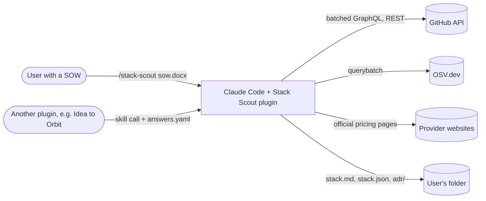
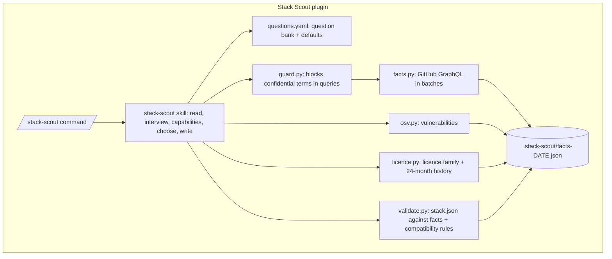
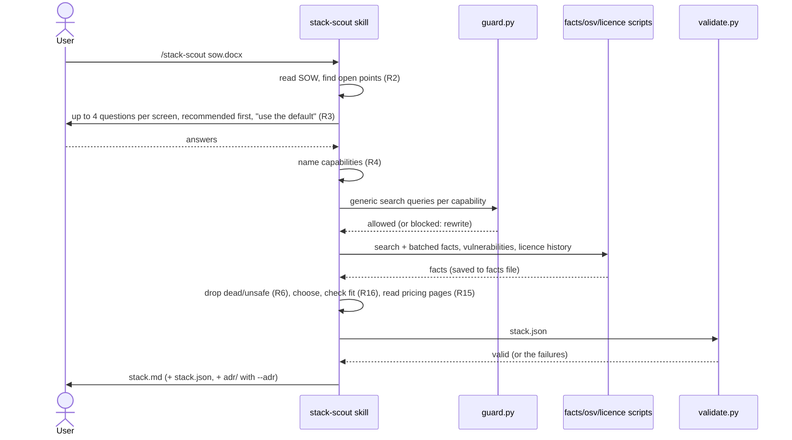

# Architecture: Stack Scout

Version 1, 2026-11-27. PRD: [prd.md](prd.md). Decisions: [adr/](adr/). Profile: startup (nothing hosted).

## Summary
Stack Scout is a Claude Code plugin. The user runs `/stack-scout` with a SOW. The **stack-scout skill**, run by the
user's own model, does the reasoning:
1. reads the SOW and finds its open points;
2. interviews the user, or reads an answers file;
3. names the capabilities, then asks **standard-library Python scripts** for every fact.

The scripts fetch GitHub facts in batches, vulnerabilities from OSV, licence history and service prices, and they
guard every search query. The model picks among **verified** candidates and writes `stack.md` and `stack.json`.
`validate.py` then rejects anything not backed by this run's facts. Nothing runs on a server, and nothing costs money.

## Context

## Containers

| Container | Responsibility | Technology | Scales to zero? |
|---|---|---|---|
| `/stack-scout` command | Entry point; flags `--answers`, `--defaults`, `--private-terms`, `--adr` | Claude Code command | n/a |
| `stack-scout` skill | Reading, open points, interview, capabilities, choosing, writing; follows the guardrails (ADR 0006) | Skill (Markdown) | n/a |
| Question bank | Open points, ranked, each with options and a default | `questions.yaml` | n/a |
| `guard.py` | Builds the protected-terms list from the SOW and the answers; rejects queries containing them | Python stdlib | Runs per call |
| `facts.py` | Search candidates per capability; batched repository facts; contributor counts for finalists | Python stdlib, GitHub GraphQL and REST (ADR 0002) | Runs per call |
| `osv.py` | Vulnerabilities for finalists' packages | OSV.dev querybatch (ADR 0003) | Runs per call |
| `licence.py` | Licence family now and 24 months ago | GitHub REST (ADR 0004) | Runs per call |
| `validate.py` | Every claim in `stack.json` against the facts file; pricing links; compatibility rules (R16) | Python stdlib + JSON Schema subset | Runs per call |
| Installers, checks, CI | As in Idea to Orbit | Bash, PowerShell, Python, GitHub Actions on 3 platforms | n/a |

## Key flows

### A user turns a SOW into a stack

### Another tool calls it with nobody present (R14)
`/stack-scout sow.md --answers answers.yaml`, or `--defaults`. The interview is skipped, every default used is
listed as "assumed", and the rest is the same flow.

### Failure path: rate-limited or no token
1. `facts.py` gets a 403 or 429. It backs off and retries, at most 3 times.
2. Then it saves what it has and marks the rest "to verify".
3. Without a token it runs in a slow mode and says what it skipped.
4. The skill never fills a gap from memory: `validate.py` would reject it. `stack.md` lists what could not be checked
   and how to finish the check (sign in to `gh`, rerun).

## Data model

| Entity | Fields | Relationships | Owner |
|---|---|---|---|
| Answers | open point id, answer, source (user, file, default = assumed) | one run | skill |
| Capability | id, name (generic), from which SOW requirement, layer | many candidates | skill |
| Fact (facts file) | key (repo, package, url), field, value, source URL, fetched at | many per candidate | scripts |
| Candidate | repo, capability, facts, verdict (kept, dropped: reason) | one capability | skill + scripts |
| Stack (`stack.json`) | facts as of, layers[choice, reason, alternative, projects, services, risks], assumed answers, to-verify list, cost estimate, outcome per capability | candidates, facts | skill, checked by `validate.py` |

## Interfaces

| Interface | Type | Contract | Consumers |
|---|---|---|---|
| `/stack-scout <sow> [--answers f] [--defaults] [--private-terms f] [--adr]` | Claude Code command | Writes `stack.md`, `stack.json`, optional `adr/`; exit summary lists to-verify items | users, other plugins |
| `questions.yaml` | YAML | `[{id, ask, options[2-4], default, changes: [layers]}]` | skill, evals |
| `answers.yaml` | YAML | `{open_point_id: answer}`; unknown ids rejected | non-interactive callers |
| Scripts | `python scripts/<name>.py ...` | JSON on stdout; exit code 0 ok, 2 blocked or invalid, 3 rate-limited; never print a token | skill |
| `stack.json` | JSON, `schema/stack.schema.json` | as in the data model; versioned (`"schema": 1`) | Idea to Orbit, other tools |
| ADRs | Markdown | Idea to Orbit's ADR template | Idea to Orbit's Blueprint |

## Security
- **Secrets:** the GitHub token is read from `GITHUB_TOKEN` or `gh auth token` at call time. It is never written to the
  facts file, `stack.md` or logs, and the scripts redact it from errors.
- **Confidential input:** only generic queries leave the machine (`guard.py`, N3). The SOW stays in the user's session
  and is never sent to GitHub or OSV.
- **No telemetry.** The facts file stays in the user's folder (`.stack-scout/`), and the installer suggests adding it
  to `.gitignore`.

## AI

| Topic | Design |
|---|---|
| Model for which job | The user's own Claude Code model does the reasoning and writing (ADR 0006). It is not chosen by us: the plugin works with whatever model the session uses |
| May never decide | Any fact (stars, licence, vulnerability, price, existence) not in the facts file; any search query not passed by `guard.py` |
| Checks in code | `validate.py`: every project and number matches the facts file; pricing links dated; compatibility rules; an empty capability needs an explicit outcome |
| Evals (bars from the PRD) | Facts 100% correct on 20 labelled test SOWs; planted fake, archived, relicensed and vulnerable projects never kept; planted client name never in a query; planted mismatch caught; 8 questions or fewer; within about 200 tool calls |
| Metering | Each run writes `run.json`: script calls made, GitHub points used (from GraphQL `rateLimit`), questions asked, time. The skill stops at about 200 tool calls and returns a partial, validated result with a note (N1) |

## Cost

| Part | Expected per month | At 10× | Free tier used |
|---|---|---|---|
| For users | Rs 0 (their own Claude plan; GitHub and OSV free) | Rs 0 | GitHub API, OSV |
| For us | Rs 0 (GitHub Actions on a public repo) | Rs 0 | GitHub Actions |
| **Total** | **Rs 0** | **Rs 0** | |

Spending cap: not applicable (nothing billed). The real limit is each user's Claude quota, which the 200-call cap
protects.

## Failure modes

| Failure | Detection | Recovery |
|---|---|---|
| GitHub rate limit or no token | 403/429, `rateLimit` | Back off, retry 3 times, mark "to verify"; tell the user how to finish |
| OSV down or partial | HTTP error, `next_page_token` | Retry, then "vulnerabilities: to verify" for those finalists |
| Pricing page unreadable | Fetch fails, no price found | "to verify"; the estimate marks that part unknown |
| Model names an unverified project | `validate.py` fails | Fix from the facts file or mark "to verify"; never shipped unvalidated |
| Confidential term in a query | `guard.py` exit 2 | Rewrite the query generically |
| Tool-call cap reached | Skill's count | Stop; partial validated stack with a note |
| No good open-source project | Every candidate dropped | Explicit outcome: build it yourself, or a managed service (R7) |
| Question tool missing | Tool not available | Numbered text questions |

## Traceability

| Requirement | Satisfied by |
|---|---|
| R1 | skill reads text, Markdown, PDF and .docx (the model's own file reading; .docx through a stdlib unzip in `scripts/sow.py`) |
| R2, R3, R14 | skill + `questions.yaml` + `answers.yaml` (ADR 0005) |
| R4 | skill (capabilities) |
| R5 | `facts.py` (ADR 0002), `osv.py` (ADR 0003) |
| R6 | `licence.py` (ADR 0004) + skill rules + `validate.py` |
| R7, R8 | skill writing `stack.md` and ADRs from templates |
| R9, R10 | facts file sources + `validate.py` |
| R11 | installers and CI, from Idea to Orbit |
| R12 | command + `stack.json` (schema) |
| R13 | not in version 1 (CLI later, ADR 0001) |
| R15 | pricing URL list + `validate.py` (ADR 0007) |
| R16 | `validate.py` compatibility rules (ADR 0006) |
| N1 | ADR 0006, `run.json` cap |
| N2 | `validate.py`, evals |
| N3 | `guard.py`, eval with a planted name |
| N4 | timed evals |
| N5 | release rules from Idea to Orbit |
| N6 | back-off in scripts, rate-limit tests |
| N7 | offline checks + pressure scenarios in CI on 3 platforms |
