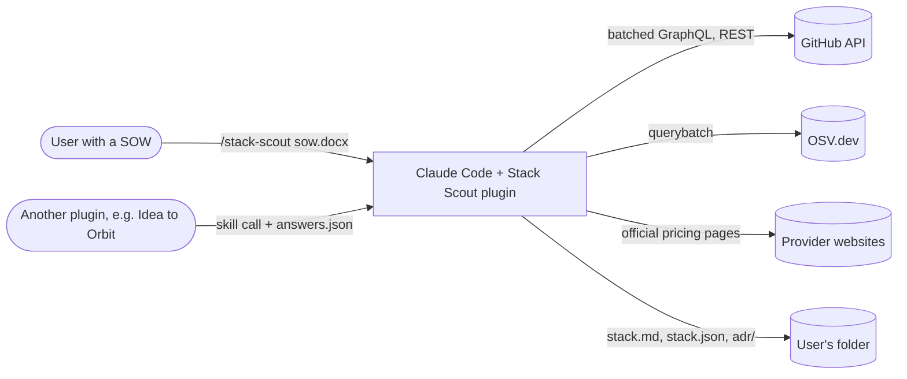
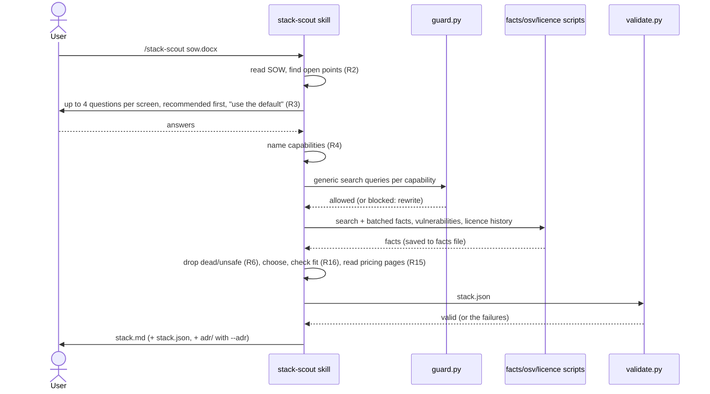

# Architecture: Stack Scout

Version 1, 2026-11-27. PRD: [prd.md](prd.md). Decisions: [adr/](adr/). Profile: startup (nothing hosted).

## Summary
Stack Scout is a Claude Code plugin. The user runs `/stack-scout` with a SOW. The **stack-scout skill**, run by the
user's own model, does the reasoning:
1. reads the SOW and finds its open points;
2. interviews the user, or reads an answers file;
3. names the capabilities, then asks **standard-library Python scripts** for every fact.

The scripts fetch GitHub facts in batches, vulnerabilities from OSV, licence history and service prices, and they
guard every search query. The model picks among **verified** candidates and writes `stack.md` and `stack.json`.
`validate.py` then rejects anything not backed by this run's facts. Nothing runs on a server, and nothing costs money.

## Context

## Containers

| Container | Responsibility | Technology | Scales to zero? |
|---|---|---|---|
| `/stack-scout` command | Entry point; flags `--answers`, `--defaults`, `--private-terms`, `--adr` | Claude Code command | n/a |
| `stack-scout` skill | Reading, open points, interview, capabilities, choosing, writing; follows the guardrails (ADR 0006) | Skill (Markdown) | n/a |
| Question bank | Open points, ranked, each with options and a default | `questions.json` | n/a |
| `guard.py` | Builds the protected-terms list from the SOW and the answers; rejects queries containing them | Python stdlib | Runs per call |
| `facts.py` | Search candidates per capability; batched repository facts; contributor counts for finalists | Python stdlib, GitHub GraphQL and REST (ADR 0002) | Runs per call |
| `osv.py` | Vulnerabilities for finalists' packages | OSV.dev querybatch (ADR 0003) | Runs per call |
| `licence.py` | Licence family now and 24 months ago | GitHub REST (ADR 0004) | Runs per call |
| `validate.py` | Every claim in `stack.json` against the facts file; pricing links; compatibility rules (R16) | Python stdlib + JSON Schema subset | Runs per call |
| Installers, checks, CI | As in Idea to Orbit | Bash, PowerShell, Python, GitHub Actions on 3 platforms | n/a |

## Key flows

### A user turns a SOW into a stack

### Another tool calls it with nobody present (R14)
`/stack-scout sow.md --answers answers.json`, or `--defaults`. The interview is skipped, every default used is
listed as "assumed", and the rest is the same flow.

### Failure path: rate-limited or no token
1. `facts.py` gets a 403 or 429. It backs off and retries, at most 3 times.
2. Then it saves what it has and marks the rest "to verify".
3. Without a token it runs in a slow mode and says what it skipped.
4. The skill never fills a gap from memory: `validate.py` would reject it. `stack.md` lists what could not be checked
   and how to finish the check (sign in to `gh`, rerun).

## Data model

| Entity | Fields | Relationships | Owner |
|---|---|---|---|
| Answers | open point id, answer, source (user, file, default = assumed) | one run | skill |
| Capability | id, name (generic), from which SOW requirement, layer | many candidates | skill |
| Fact (facts file) | key (repo, package, url), field, value, source URL, fetched at | many per candidate | scripts |
| Candidate | repo, capability, facts, verdict (kept, dropped: reason) | one capability | skill + scripts |
| Stack (`stack.json`) | facts as of, layers[choice, reason, alternative, projects, services, risks], assumed answers, to-verify list, cost estimate, outcome per capability | candidates, facts | skill, checked by `validate.py` |

## Interfaces

| Interface | Type | Contract | Consumers |
|---|---|---|---|
| `/stack-scout <sow> [--answers f] [--defaults] [--private-terms f] [--adr]` | Claude Code command | Writes `stack.md`, `stack.json`, optional `adr/`; exit summary lists to-verify items | users, other plugins |
| `questions.json` | JSON | see "Implementation decisions" below | skill, evals |
| `answers.json` | JSON | see "Implementation decisions" below | non-interactive callers |
| Scripts | `python scripts/<name>.py ...` | JSON on stdout; exit code 0 ok, 2 blocked or invalid, 3 rate-limited; never print a token | skill |
| `stack.json` | JSON, `schema/stack.schema.json` | as in the data model; versioned (`"schema": 1`) | Idea to Orbit, other tools |
| ADRs | Markdown | Idea to Orbit's ADR template | Idea to Orbit's Blueprint |

## Security
- **Secrets:** the GitHub token is read from `GITHUB_TOKEN` or `gh auth token` at call time. It is never written to the
  facts file, `stack.md` or logs, and the scripts redact it from errors.
- **Confidential input:** only generic queries leave the machine (`guard.py`, N3). The SOW stays in the user's session
  and is never sent to GitHub or OSV.
- **No telemetry.** The facts file stays in the user's folder (`.stack-scout/`), and the installer suggests adding it
  to `.gitignore`.

## AI

| Topic | Design |
|---|---|
| Model for which job | The user's own Claude Code model does the reasoning and writing (ADR 0006). It is not chosen by us: the plugin works with whatever model the session uses |
| May never decide | Any fact (stars, licence, vulnerability, price, existence) not in the facts file; any search query not passed by `guard.py` |
| Checks in code | `validate.py`: every project and number matches the facts file; pricing links dated; compatibility rules; an empty capability needs an explicit outcome |
| Evals (bars from the PRD) | Facts 100% correct on 20 labelled test SOWs; planted fake, archived, relicensed and vulnerable projects never kept; planted client name never in a query; planted mismatch caught; 8 questions or fewer; within about 200 tool calls |
| Metering | Each run writes `run.json`: script calls made, GitHub points used (from GraphQL `rateLimit`), questions asked, time. The skill stops at about 200 tool calls and returns a partial, validated result with a note (N1) |

## Cost

| Part | Expected per month | At 10× | Free tier used |
|---|---|---|---|
| For users | Rs 0 (their own Claude plan; GitHub and OSV free) | Rs 0 | GitHub API, OSV |
| For us | Rs 0 (GitHub Actions on a public repo) | Rs 0 | GitHub Actions |
| **Total** | **Rs 0** | **Rs 0** | |

Spending cap: not applicable (nothing billed). The real limit is each user's Claude quota, which the 200-call cap
protects.

## Failure modes

| Failure | Detection | Recovery |
|---|---|---|
| GitHub rate limit or no token | 403/429, `rateLimit` | Back off, retry 3 times, mark "to verify"; tell the user how to finish |
| OSV down or partial | HTTP error, `next_page_token` | Retry, then "vulnerabilities: to verify" for those finalists |
| Pricing page unreadable | Fetch fails, no price found | "to verify"; the estimate marks that part unknown |
| Model names an unverified project | `validate.py` fails | Fix from the facts file or mark "to verify"; never shipped unvalidated |
| Confidential term in a query | `guard.py` exit 2 | Rewrite the query generically |
| Tool-call cap reached | Skill's count | Stop; partial validated stack with a note |
| No good open-source project | Every candidate dropped | Explicit outcome: build it yourself, or a managed service (R7) |
| Question tool missing | Tool not available | Numbered text questions |

## Traceability

| Requirement | Satisfied by |
|---|---|
| R1 | skill reads text, Markdown, PDF and .docx (the model's own file reading; .docx through a stdlib unzip in `scripts/sow.py`) |
| R2, R3, R14 | skill + `questions.json` + `answers.json` (ADR 0005) |
| R4 | skill (capabilities) |
| R5 | `facts.py` (ADR 0002), `osv.py` (ADR 0003) |
| R6 | `licence.py` (ADR 0004) + skill rules + `validate.py` |
| R7, R8 | skill writing `stack.md` and ADRs from templates |
| R9, R10 | facts file sources + `validate.py` |
| R11 | installers and CI, from Idea to Orbit |
| R12 | command + `stack.json` (schema) |
| R13 | not in version 1 (CLI later, ADR 0001) |
| R15 | pricing URL list + `validate.py` (ADR 0007) |
| R16 | `validate.py` compatibility rules (ADR 0006) |
| N1 | ADR 0006, `run.json` cap |
| N2 | `validate.py`, evals |
| N3 | `guard.py`, eval with a planted name |
| N4 | timed evals |
| N5 | release rules from Idea to Orbit |
| N6 | back-off in scripts, rate-limit tests |
| N7 | offline checks + pressure scenarios in CI on 3 platforms |

## Implementation decisions (answers to the cold read, 2026-11-27)

A fresh agent planned the tasks from this design and listed where it would have to guess. The answers:

1. **Schemas come first and are written by hand** (`schema/stack.schema.json`, `facts.schema.json`,
   `run.schema.json`, `questions.schema.json`, `answers.schema.json`) in the first task, before any script.
   `validate.py` implements a small JSON Schema subset: `type`, `required`, `properties`, `additionalProperties`,
   `items`, `enum`, `pattern`, `minimum`, `maximum`. Shapes:
   - **Fact:** `{"subject": "github:owner/repo" | "osv:ecosystem/package" | "price:service", "field": "stars",
     "value": ..., "source": "<url>", "fetched_at": "<UTC ISO time>", "by": "script" | "model-read"}`.
     `facts-DATE.json` is `{"schema": 1, "facts": [Fact, ...]}`.
   - **Stack:** `{"schema": 1, "facts_as_of": "<UTC date>", "partial": bool, "unchecked": [string],
     "assumed": [{"id", "answer"}], "layers": [{"layer", "choice", "reason", "alternative": {"name", "why_not"},
     "projects": [{"subject"}], "services": [{"subject"}], "risks": [string]}],
     "capabilities": [{"id", "name", "outcome": "project" | "service" | "build-yourself"}],
     "accepted": [{"subject", "what"}], "cost": {"monthly_estimate", "currency", "parts": [...], "unknown_parts": [...]}}`.
     Facts are referenced by `subject`, never copied, so `stack.md` is rendered from `stack.json` plus the facts file.
   - **Run:** `{"schema": 1, "started", "ended", "script_calls", "github_points", "questions_asked", "partial"}`.
2. **What `validate.py` checks:** every `subject` in `stack.json` exists in the facts file. For each project, these
   fields are present: `exists`, `stars`, `licence`, `pushed_at`, `archived`, `latest_release`, `vulnerabilities`,
   with `licence_history` for finalists. Values are not compared, because `stack.md` is rendered from the facts
   file, so a number can't drift. Every priced service has a `price:` fact with `source` and `fetched_at`. A price
   the model read from a page is recorded with **`facts.py record-price --service --url --amount --unit`**, which
   writes it with `"by": "model-read"`.
3. **Search:** `facts.py search --capability "<generic words>" [--language X]` calls GitHub's repository search,
   sorted by stars, and returns up to 10 candidates. Candidates the model already knows are checked with
   `facts.py verify owner/repo ...`. Awesome-lists are not in version 1. **`facts.py` runs `guard.py` itself on every
   query before any network call** (enforced in code, exit 2 when blocked), so no query can skip the guard.
4. **Guard rules:** the protected terms are:
   - the answer to a standard interview question, "names to keep private (client, product, project)";
   - the `--private-terms` file (plain text, one term per line);
   - words the code extracts from the SOW: capitalised words and phrases that are not on a common-word list
     (`data/common-words.txt`).

   Matching is case-insensitive, on whole words. False positives only make a query more generic, which is safe.
5. **`scripts/sow.py <file>`:** `.docx` is unzipped with the standard library and turned into plain text, with
   Heading styles kept as `#` lines; `.md` and `.txt` pass through. PDFs are read by the model's own file reading. A
   scanned or encrypted file exits with code 2 and the message "can't read this file: paste the text instead".
6. **Question bank:** `skills/stack-scout/questions.json` is fixed and written in the repo (a content task):
   `[{"id", "ask", "options": [2-4 strings], "default", "changes": [layer names], "rank"}]`. The model asks only the
   bank questions the SOW leaves open, in rank order, and may add at most 2 SOW-specific questions within the
   8-question limit. **`answers.json`** is `{"<id>": "<answer>"}`. Missing ids take the default and are listed as
   assumed; unknown ids are an error.
7. **Formats are JSON or plain text, never YAML**, because the standard library has no YAML parser.
8. **Metering:** each script adds its calls and GitHub points to `run.json`. Scripts can't see the model's own tool
   calls, so **the 200-call cap is skill instruction, measured in the evals** from the session transcript. It is not
   enforced in code.
9. **Rules and data files:**
   - `data/licences.json` maps SPDX ids and known phrases to a family (permissive, copyleft, source-available).
     Unknown text is "to verify".
   - `data/rules.json` holds the constants: dead after 12 months without a push (`pushedAt`), relicence window
     24 months, cap 200 calls, 8 questions.
   - The latest release date is reported separately and isn't used for "dead".
   - `data/pricing-urls.json` lists official pricing pages, `{"<service>": "<url>"}`.
   - `data/compat.json` holds the compatibility rules: language families per ecosystem, and declared-runtime fields
     per manifest (`engines.node`, `requires-python`, the `go` directive, `rust-version`).
10. **Layout copied from Idea to Orbit:**
    - `.claude-plugin/plugin.json` and `marketplace.json`, the `install.sh` and `install.ps1` pattern (no hook;
      scripts copied to `<config>/stack-scout/`), `tests/check.py` and the CI matrix.
    - The skill finds its scripts through `${CLAUDE_PLUGIN_ROOT}/scripts` when installed as a plugin, and
      `<config>/stack-scout/scripts` when installed by script.
    - `--uninstall` works as in Idea to Orbit.
    - At the end of a run the command prints a suggestion to add `.stack-scout/` to `.gitignore`. It never edits
      that file itself.
11. **ADRs** come from Idea to Orbit's ADR template, copied into `skills/stack-scout/templates/adr.md`. Our own
    offline check confirms each ADR has the template's headings.

**Parts the design did not name, now named:**
- `scripts/sow.py`, the `data/*.json` files above, and `skills/stack-scout/templates/stack.md`. `stack.md` is
  rendered from `stack.json` by `scripts/render.py`, which also enforces "no unlinked fact", because every fact it
  prints comes with its source link.
- **The eval harness:** `tests/fixtures/sows/*.md` with `labels.json` (expected open points, planted mismatch,
  planted client name, planted dead, relicensed and vulnerable projects). Offline script tests use a stdlib
  `http.server` mock of GitHub and OSV, including 403, 429 and `next_page_token` pages. Pressure scenarios run as in
  Idea to Orbit.
- **The clock:** scripts stamp UTC times, and `facts_as_of` is the run's start date.
- **Partial results:** `"partial": true` plus the `unchecked` list. Before exiting with code 3 when rate-limited,
  `facts.py` saves what it has.
- **Accepted licence conflicts:** when the user accepts one in the interview, it is recorded under `accepted` in
  `stack.json`.
- **Existing files:** a new run moves the old `stack.md` and `stack.json` to `stack.prev.*`. A same-day facts file
  is merged by `(subject, field)`, and the newest value wins.
- **Paging:** contributor counts use the REST `per_page=1` trick (the last page number), and OSV pages follow
  `next_page_token` until done.
- **No question tool:** the questions appear as a numbered text list, each answered with an option number or
  "default".
- **Token redaction:** a test runs every script with a fake token and checks that it appears in no output, file or
  error message.

## Blueprint review fixes (2026-11-27)

An outside review (8.5/10) found these; each is now part of the design:

1. **ADR 0006 now matches point 2 above:** values are rendered from the facts file, not compared.
2. **No facts in prose:** `validate.py` rejects digits and licence names (from `data/licences.json`) in `reason`,
   `why_not` and `risks`. Facts appear only as values rendered from the facts file.
3. **Technology words are never private:** `data/tech-terms.txt`, built from GitHub's topic names, sits next to
   `common-words.txt`. "Azure", "PostgreSQL", "React" and "Kubernetes" stay searchable.
4. **The model's own searches:** the skill runs `guard.py check "<query>"` before any web search or page lookup it
   makes itself. This can't be enforced in code, so a transcript eval checks it, as with the 200-call cap.
5. **No-token mode is REST only** (GraphQL needs a token): basic facts for finalists, the rest "to verify", and a
   prompt to run `gh auth login`.
6. **Model-read prices are checked:** `facts.py record-price` fetches the URL and keeps the price only if the amount
   appears in the page text. Otherwise the price is "to verify". Pages that draw prices with JavaScript therefore
   come out as "to verify", which is honest.
7. **Last activity** is the last commit by a non-bot author on the default branch, not `pushedAt` (ADR 0002).
8. **Repository to package** uses deps.dev, which also gives the OpenSSF Scorecard (ADR 0003).
9. **The licence file** is found through `/repos/{owner}/{repo}/license`, and renames are followed (ADR 0004).
10. **`sow.py` reads tables** (`w:tbl`) in `.docx` files as well as paragraphs, row by row, with cells separated by
    `|`, because SOWs often put their requirements in tables.
11. **Non-interactive runs and the SOW-specific questions:** the up to 2 questions the model adds (not in the bank)
    take the model's recommended option and are listed as assumed, with the question text, in `stack.json`.
